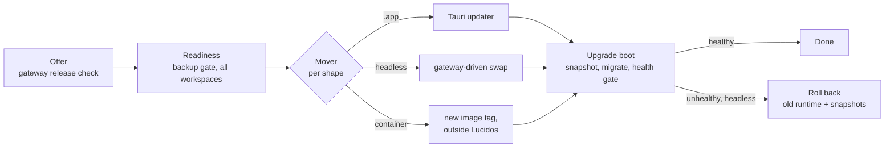

# 0625: Every install shape updates through one gateway-owned flow: a backup gate, a pre-migration snapshot, a health gate and rollback

- **Status**: Proposed
- **Date**: 2026-11-07
- **Amends**: [0108](0108-update-check-lives-in-the-gateway.md) ("announce,
  never install" and the rejected "gateway runs `install.sh`"),
  [0142](0142-no-newer-release-without-a-route.md) (a headless install's route
  becomes `install`)
- **Relates to**: 0045 and 0478 (switch and resume), 0139 (check on notice),
  0153 and 0520 (backups), 0509 (sealed secrets), 0543 (update address), 0612
  (snapshots), 0622 (OAuth callback)
- **Plan**: [`docs/plans/2026-11-07-one-update-flow-for-every-install-shape.md`](../plans/2026-11-07-one-update-flow-for-every-install-shape.md)

## Context

Lucidos runs in three install shapes, and each takes an update a different way:

| Shape | How it learns | How it updates today |
|---|---|---|
| macOS `.app` | gateway release check (0108) | Tauri updater, **Update & Restart**, no confirm |
| Headless tarball on a VPS (`install.sh`, systemd or launchd) | gateway release check | the user copies an `install.sh` command and runs it over SSH |
| Container (Kubernetes, Docker) | nothing ships | no image exists |

A user asked for an easy update path for cloud and Linux installs, both a VPS
and Kubernetes. Reading the code found these gaps:

- **No update path protects data.** No path takes a backup or a snapshot first.
  Migrations have no down step, so an older engine refuses a newer database.
  A failed update therefore has no way back.
- **The headless command silently drops settings.** `installer_command` passes
  only `--name` and `--prefix`. `install.sh` re-bakes TLS and provider keys from
  the flags of the current run only. A TLS install then serves plain http after
  an update.
- **A headless re-run reads as a crash.** No restart intent reaches the
  engines, so their running threads settle failed and need **Continue**.
- **A Postgres major bump would empty every workspace.** The gateway sets a
  foreign-major `pgdata` aside and runs `initdb`. No cross-major path exists.
- **Tarballs carry a checksum, not a signature.** The `.sha256` comes from the
  same origin as the tarball, so it proves integrity only.
- **State has no written contract.** On a default install it all sits under
  `~/.lucidos`. `--prefix` and `LUCIDOS_GATEWAY_DATA` can split it, and no doc
  says which paths a rebuild must keep.

## Decision

**One update flow, four stages, for every install shape.** Only the stage that
replaces the binary differs per shape.

1. **Readiness is one gate, owned by the gateway.** It reads the backup state
   of every workspace on the gateway, because one binary serves all of them.
   Every surface reads it: the update dialog, the CLI and automatic updates.
2. **"Recent" means younger than `BACKUP_STALE_AFTER_SECONDS`** (24 hours). A
   backup still running does not count until its `BackupCompleted` lands.
3. **The gate offers the existing backup and never builds a new one.** It
   offers **Back up now** per workspace, through the existing encrypted
   pipeline. Each blocking state has its own copy, and the user can always
   update anyway.
4. **The engine snapshots before it migrates.** On boot, an engine with pending
   migrations first takes and checks a local snapshot (0612). This covers every
   shape, and a stopped workspace at its first start. No snapshot means no
   migration, unless the owner overrides it once. A database with no applied
   migration holds nothing to keep, so it migrates without a snapshot. The
   capture reads the old schema, never the new binary's.
5. **A headless install updates itself on request.** The gateway downloads,
   verifies and extracts the new runtime while it keeps serving. A one-shot
   helper, outside the service's lifetime, does the swap. The swap never
   rewrites the unit file, so TLS and the environment survive.
6. **A health gate follows every headless swap, and failure rolls back.** The
   gate waits for the gateway and every workspace that ran before. Rollback
   re-links the old runtime and restores the snapshots of the workspaces that
   migrated.
7. **The update journal is a file, never events.** Rollback rewinds each
   workspace database, so a record inside it would vanish. This is 0612
   decision 5 again.
8. **An interactive update resumes threads.** The gateway sends the clicking
   device's restart intent, so the 0045 promise holds. An automatic update
   waits for a quiet moment instead, so nothing needs a resume.
9. **Automatic updates are opt-in, per machine.** They run from the gateway's
   own release check, after a soak period, in a time window. They make a fresh
   backup first, and a failed backup holds the update.
10. **Headless tarballs are signed, and the gateway verifies the signature.**
    The release signs on the maintainer's machine before it publishes. The
    public key is baked into the binary. The update address (0543) moves where
    the gateway looks, never what it trusts.
11. **A container image per release wraps the signed Linux tarball.** The
    image runs one replica on one volume. Lucidos never holds cluster
    credentials, so the in-app route for a container is `guide`.
12. **`$HOME/.lucidos` is the Lucidos home.** Everything in it except `runtime/`
    and caches is state. A container mounts its volume as `$HOME`.
13. **No release changes the bundled Postgres major without a cross-major
    path.** The gateway refuses such an update until that path exists.

## Rationale

**One gate, because three gates drift.** The `.app`, the headless swap and an
automatic update would each grow their own copy of "is it safe". The gateway
already supervises every workspace and already polls each engine's
last-successful backup for the picker. It is the only process that sees the
whole set.

**Reuse the backup, add no backup.** The encrypted backup is the only copy that
leaves the disk. A second mechanism would need its own key, storage and
restore. None of that is cheaper than a button on the dialog.

**The snapshot belongs to the migration, not to the mover.** Only the engine
knows whether migrations are pending, and it already holds the role, the tools
and the key store. Tying the snapshot to the migration covers the `.app`, the
headless swap, a container tag bump and a stopped workspace with one rule.

**The off-site backup and the local snapshot do different jobs.** The snapshot
is the fast way back on the same disk, and it needs no key from the user. The
backup survives a lost disk. The dialog shows both, and neither replaces the
other.

**Why the gateway may now install.** 0108 rejected a gateway that runs
`install.sh`, because `launchctl bootout` kills the job's process group. The
helper here runs as its own one-shot unit, outside the gateway's group. The
copyable command stays, and it is now the fallback rather than the only route.

**Why a quiet window for automatic updates.** The resume gate trusts
`EngineShutdown` only with a device actor, to stop crash loops. An automatic
update has no device. Waiting until no turn runs avoids a new actor kind and
keeps that rule whole.

**Opt-in, because an install is an action.** Principle 1 says background upkeep
reads and notifies, and acting needs the user. Turning on automatic updates is
that intent, given once.

**Lucidos never edits the cluster.** An updater with cluster write access is a
credential an agent could reach. The user's own tooling changes the image tag,
and Lucidos makes that safe at boot.

## Consequences

- A headless install gets **Update & Restart** in Settings, System from any
  paired browser. The copyable command remains for SSH.
- The `.app` gains a confirm before it installs, since the backup step needs a
  place to live. That is one more tap.
- Every boot with pending migrations costs a snapshot. A large workspace starts
  slower on the first boot of a release. Dev workspaces pay it too, after an
  Apply that adds a migration.
- A full disk now stops a migration instead of risking it. The boot-failure
  card names the free-space floor and the one-time override.
- The `.app` and containers get no automatic binary rollback. Their way back is
  the previous artifact plus the snapshot, and the boot-failure card says so.
- Release publishing gains a signing step and a public key to protect.
  `install.sh` piped from the web still checks only the checksum, because a
  POSIX shell cannot verify the signature.
- The persistent-data contract becomes a documented promise. Paths outside it
  need a migration note when they move.

## Alternatives considered

**A systemd timer that pipes `install.sh` nightly.** Rejected. It runs outside
the gateway, so it cannot read readiness, wait for quiet or roll back. It also
re-bakes the unit and drops TLS, the defect above.

**A dedicated `pg_dump` before each update.** Rejected by the user. The backup
and the snapshot already hold a dump, with keys and restore paths that work.

**Snapshot in the mover, before the swap.** Rejected. A container tag bump has
no mover inside Lucidos, and a stopped workspace has no running engine to ask.
The boot-time rule covers both.

**An operator or a controller that updates the cluster.** Rejected for now. It
needs cluster credentials and a second product to maintain. It stays open if
users ask for it.

**Down migrations.** Rejected. They double every migration's cost and still
cannot undo a lossy one. The snapshot restores the exact earlier state.

**Automatic updates on by default.** Rejected. It installs code with nobody
watching, which turns a compromised release key into a fleet compromise. The
soak period and the signature narrow that risk, and opt-in keeps the decision
with the owner.
